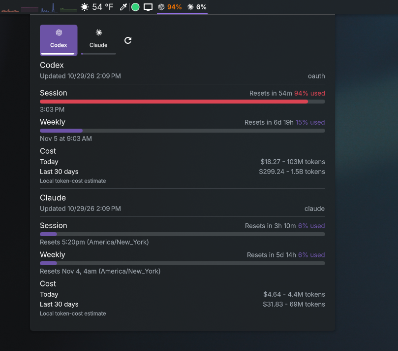

# KodexBar

> AI provider usage limits, right in your KDE Plasma panel.

[](https://kde.org/plasma-desktop/)
[](https://github.com/steipete/CodexBar)
[](LICENSE)

KodexBar is a native Plasma 6 widget, inspired by [CodexBar](https://github.com/steipete/CodexBar), that shows rate limits, credits, and spend for Codex, Claude, OpenAI, Gemini, Copilot, OpenRouter, Bedrock, GroqCloud, and every other provider the CodexBar CLI supports.



KodexBar does not talk to providers itself. It uses the upstream `codexbar` CLI as its only data source, so authentication, provider configuration, and API access stay in CodexBar (`~/.codexbar/config.json`). KodexBar handles the panel and popup UI.

## Features

- **At-a-glance panel label.** Shows the provider icon, used percentage, and remaining credits. You can show one provider or several side by side.
- **Detailed popup.** Session, weekly, and extra rate-limit windows with usage bars and reset countdowns, plus credit balances, spend and budget rows, OpenAI dashboard summaries, and provider status.
- **Local cost estimates.** Token and estimated-cost summaries from `codexbar cost`, where the CLI can scan local logs.
- **Usage colouring.** The panel label turns the theme's warning colour at 80% used and its negative colour at 95% used.
- **Works on Linux.** `Best available` mode tries the CLI defaults first, then works through Linux-friendly provider and source combinations.
- **Handles CLI failures.** Refreshes never overlap, and a stuck refresh is aborted after five minutes. Failures back off the refresh interval, and the last good data stays on screen.
- **Plasma-native.** Built with Kirigami, follows your theme, and is fully keyboard accessible.

## Requirements

- KDE Plasma 6 with `kpackagetool6`
- The [CodexBar CLI](https://github.com/steipete/CodexBar), either on `PATH` or set by full path in the widget settings
- Credentials for the providers you want to track (for example `codex login`, `claude /login`, or API keys that CodexBar supports)

## Installation

### 1. Install the CodexBar CLI

With Homebrew on Linux:

```sh
brew install steipete/tap/codexbar
```

Or download a Linux tarball from the [CodexBar releases](https://github.com/steipete/CodexBar/releases/latest).

Check that it returns data:

```sh
codexbar --version
codexbar usage --format json --pretty
```

### 2. Install the widget

Download the latest `.plasmoid` from the [releases page](https://github.com/tylxr59/KodexBar/releases/latest) and install it:

```sh
kpackagetool6 -t Plasma/Applet -i KodexBar-*.plasmoid
```

Or install from source:

```sh
git clone https://github.com/tylxr59/KodexBar.git
cd KodexBar
kpackagetool6 -t Plasma/Applet -i .
```

Right-click your panel, choose **Add Widgets…**, and add **KodexBar**.

### Updating

From a release, download the new `.plasmoid` and upgrade:

```sh
kpackagetool6 -t Plasma/Applet -u KodexBar-*.plasmoid
plasmashell --replace
```

From source:

```sh
git pull
kpackagetool6 -t Plasma/Applet -u .
plasmashell --replace
```

### Uninstalling

```sh
kpackagetool6 -t Plasma/Applet -r com.tylxr.kodexbar
```

## Usage

| Action | Result |
| --- | --- |
| Click | Open or close the popup |
| Middle-click, or the popup's refresh button | Refresh now |
| Hover | Tooltip with every provider's windows, usage, and reset times |
| <kbd>Tab</kbd>, then <kbd>Enter</kbd> or <kbd>Space</kbd> | Open or close the popup from the keyboard |

Provider charts, account management, credential editing, and notifications are still handled by the upstream CodexBar app and CLI.

## Configuration

Right-click the widget and choose **Configure KodexBar…**.

| Setting | Default | Description |
| --- | --- | --- |
| Command | `codexbar` | Binary name or absolute path to the CodexBar CLI. |
| Provider | Best available | `Best available` uses the first working provider. `All enabled` queries every provider enabled in `~/.codexbar/config.json`. You can also pick a single provider. |
| Source | Best available | `Best available`, `auto`, `web`, `cli`, `oauth`, or `api`. |
| Refresh | 60 s | Poll interval, from 10 to 3600 seconds. |
| Panel shows | First available provider | Or `Selected providers`, which shows any number of providers side by side, each with its own icon and colour. |
| Show provider name next to its icon | On | Untick to show only the icon and usage. |
| Show used percent in panel | On | Session-window usage. For Codex, falls back to weekly usage if there is no session window. |
| Show credits in panel | On | Remaining credits, when the provider reports them. |
| Show email in widget | Off | Show the account email in the popup. |
| Fetch provider status | Off | Passes `--status` to the CLI and shows incident and maintenance state. |
| Show local cost summary | On | Show `codexbar cost` token and cost estimates in the popup. |
| Colour panel text by usage | On | Warning colour at 80% used, critical colour at 95%. |

Provider credentials and which providers are enabled are set in the CodexBar config (`~/.codexbar/config.json`), not in the widget.

### Best available mode on Linux

Some CodexBar sources are macOS-only, in particular the upstream app's WebKit and browser integrations. In `Best available` mode, KodexBar first lets the CLI use its configured defaults. If that fails, it tries Linux-capable combinations in turn, such as Codex and Claude through CLI, OAuth, or API, and API- or CLI-backed providers like OpenAI, Gemini, Copilot, OpenRouter, Bedrock, GroqCloud, DeepSeek, and Ollama.

If you know which provider works on your system, select it directly. This skips the search and makes refreshes faster.

## How it works

1. Plasma loads the applet from `metadata.json` and `contents/ui/main.qml`.
2. On each refresh, the applet runs `codexbar usage --format json --json-only`.
3. The JSON is turned into provider cards, usage rows, credits, status, and the panel label.
4. A timer repeats this at the configured interval. After repeated failures it backs off (x2, x4, x8, up to 30 minutes).

## Troubleshooting

Before debugging the widget, check that the CLI works from a terminal:

```sh
codexbar usage --format json --json-only --source auto | python3 -m json.tool
codexbar usage --format json --json-only --provider codex --source oauth | python3 -m json.tool
```

| Symptom | Fix |
| --- | --- |
| `No data` | Run `codexbar usage --format json --pretty` and check that it returns usage. |
| Works in a terminal but not in the widget | Plasma may not use your shell's `PATH`. Set an absolute path in **Command**. |
| CLI or runtime error | Install `codexbar`, set its full path, or pick a provider and source that work on Linux. |
| Codex shows as signed out | Run `codex login`, then refresh the widget. |
| `Best available` picks the wrong provider | Select the provider explicitly. |
| Cost section is missing | Run `codexbar cost --format json --pretty` and check that it reports local data. |
| Status never appears | Enable **Fetch provider status**. |

## Acknowledgements

- [CodexBar](https://github.com/steipete/CodexBar) by [@steipete](https://github.com/steipete), which supplies all the data and inspired this project.
- [@Yoryoboy](https://github.com/Yoryoboy)'s fork, [Yoryoboy/KodexBar](https://github.com/Yoryoboy/KodexBar), which contributed refresh reliability, usage colouring, the detailed tooltip, middle-click refresh, and keyboard accessibility.

## License

[MIT](LICENSE)
